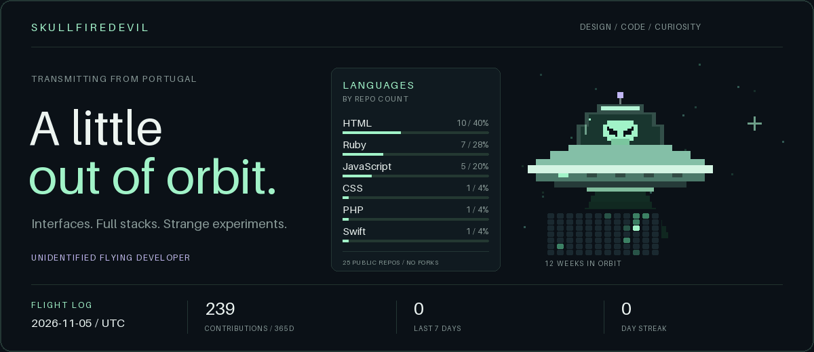

  

# Hey, I'm Skully.

I make things for the web. Sometimes that means designing an interface, sometimes it means building the whole stack, and sometimes it means following a slightly unhinged idea to see what happens.

Based in **Portugal**. Somewhere between **design, code, and curiosity**.

](https://behance.net/Skullfiredevil)    

---

### Different orbits. Same curiosity.

- **Design →** interfaces with character, thoughtful interactions, and the tiny details you notice without knowing why.
- **Development →** connecting what you see to everything happening behind it. Frontend, backend, and the bits in between.
- **Experiments →** creative coding, weird little tools, and ideas that start with “okay, but what if…”

### In the toolkit

| | Tools I work with |
| :--- | :--- |
| **Interfaces** | JavaScript · React · HTML · CSS / Sass |
| **Behind the scenes** | Node.js · Ruby / Rails · PHP · SQLite |
| **Other rabbit holes** | Python · Lua · Swift |
| **Design desk** | Figma · Photoshop |

 

> Good design gets me interested. Making it work keeps me up.

  
<b>About the visitor up there</b>

The UFO is drawn from my GitHub contribution history and refreshed daily. Recent activity powers its beam, yesterday's activity changes its flight, and a contribution streak lights up its saucer. The little alien blinks either way.

The flight log shows the last complete UTC day. The pixels below the ship are twelve weeks of contribution activity, oldest to newest, top to bottom within each column. Quiet days belong in the picture too.

The languages panel counts the primary language of each public repository I own, excluding forks and repositories without a detected language. Each repo gets one vote. Counts and percentages refresh with the UFO; archived repos are included.

Original UFO artwork and renderer live [right here](scripts/render_orbit.py).

[How it works / setup](docs/SETUP.md)

Still exploring. Still making things. Probably opening another tab.

